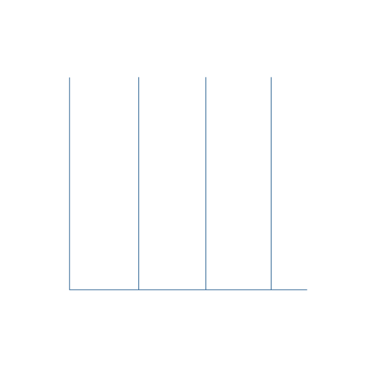

# 👋 Hi, I'm jvkit

> 全栈 & AI 独立开发者 —— Vue / Nuxt / Python / FastAPI，正在做 **OA 办公平台**、**会议语音 ASR**、**个人站** 与一堆爬虫和 CLI 小工具。
> 喜欢把想法直接做成能跑的东西：写代码 → 提交 → 部署 → 再来一杯咖啡 ☕

<p>
  <a href="https://github.com/jvkit?tab=repositories"></a>
  
  
  
</p>

<p>
  
  
</p>

---

## 📖 关于我 / About

<div align="center">

<!-- 3D 动态头部 -->


<br/><br/>

<!-- 打字机效果 - 多行酷炫文案 -->


<br/><br/>

<!-- 状态徽章矩阵 -->
<a href="https://github.com/jvkit">
  
</a>
<a href="https://github.com/jvkit?tab=repositories">
  
</a>
<a href="https://github.com/jvkit?tab=stars">
  
</a>

<br/>

<!-- 动态徽章 -->


</div>

---

<!-- 波浪分隔线 -->


##  About Me

```python
#!/usr/bin/env python3
# -*- coding: utf-8 -*-

class JunVon:
    def __init__(self):
        self.name = "jun_von"
        self.handle = "jvkit"
        self.mood = "😋 Focusing"
        self.stack = ["Vue", "Nuxt", "Python", "FastAPI", "JavaScript"]
        self.interests = ["Web Crawling", "Frontend Magic", "Terminal Themes", "Automation"]
        self.fuel = "☕ Coffee"
        self.status = "Always Building"

    def ship_it(self):
        while True:
            self.code()
            self.commit()
            self.deploy()
            self.drink_coffee()
            # Repeat forever ♾️

    def __str__(self):
        return f"{self.name} | {self.status} | {' · '.join(self.stack)}"

me = JunVon()
print(me)  # → jun_von | Always Building | Vue · Nuxt · Python · FastAPI · JavaScript
```

---

## 🏆 GitHub Trophies

<div align="center">


</div>

---

## 🛠️ Tech Arsenal

<div align="center">

<!-- 技能图标矩阵 -->


<br/><br/>

<!-- 技能进度条 -->
| Technology | Proficiency |
|:-----------|:-----------|
|  |  |
|  |  |
|  |  |
|  |  |
|  |  |
|  |  |

</div>

---

## 📦 Featured Projects

<div align="center">

<!-- 项目卡片 - 大展示 -->
<a href="https://github.com/jvkit/crwaler">
  
</a>
<a href="https://github.com/jvkit/scene">
  
</a>

<br/><br/>

<a href="https://github.com/jvkit/oh_my_posh_theme">
  
</a>
<a href="https://github.com/jvkit/excel">
  
</a>

<br/><br/>

<a href="https://github.com/jvkit/Qs_firm">
  
</a>
<a href="https://github.com/jvkit/nuxt4_qs">
  
</a>

</div>

---

## 📊 GitHub Analytics

<div align="center">

<!-- 主统计 + 语言统计 -->


<br/><br/>

<!-- 连续提交统计 -->


<br/><br/>

<!-- 3D 贡献图 -->


</div>

---

## 🐍 Contribution Snake

<div align="center">

<!-- 蛇形动画（需 GitHub Actions 生成，配置 workflow 后生效） -->
<picture>
  <source media="(prefers-color-scheme: dark)" srcset="https://raw.githubusercontent.com/jvkit/jvkit/output/github-contribution-grid-snake-dark.svg" />
  <source media="(prefers-color-scheme: light)" srcset="https://raw.githubusercontent.com/jvkit/jvkit/output/github-contribution-grid-snake.svg" />
  
</picture>

</div>

---

## 🎯 Activity Graph

<div align="center">


</div>

---

## 💻 Dev Quote

<div align="center">


</div>

---

<div align="center">

<!-- 底部波浪 -->


<br/>

**Made with 🔥 and ☕ by jvkit**


</div>

---

<a id="repos"></a>

## 📚 我的仓库导航

> 共 **73** 个仓库，按用途分成 **10** 组（组内按最近更新排序；🔒 = 私有仓库，需授权访问）。

### 🤖 AI/LLM (10)

- [deepseek_search](https://github.com/jvkit/deepseek_search) — Python
- [owu_serve](https://github.com/jvkit/owu_serve) — Python 🔒
- [webui](https://github.com/jvkit/webui) — Python 🔒
- [litellm](https://github.com/jvkit/litellm) — Python
- [kimi-code](https://github.com/jvkit/kimi-code) — The Starting Point for Next-Gen Agents
- [owu-feedback](https://github.com/jvkit/owu-feedback) — HTML
- [openwebui_2](https://github.com/jvkit/openwebui_2) — TypeScript
- [kimi-cli](https://github.com/jvkit/kimi-cli) — Kimi Code CLI is your next CLI agent.
- [MuMuAINovel](https://github.com/jvkit/MuMuAINovel) — 一款基于 AI 的智能小说创作助手，帮助你轻松创作精彩故事
- [kimi-test](https://github.com/jvkit/kimi-test)

### 🎙️ 语音ASR (2)

- [ASR-fullstack](https://github.com/jvkit/ASR-fullstack) — Python
- [ASR-service](https://github.com/jvkit/ASR-service) — Python

### 🌐 网站前端 (12)

- [duanju](https://github.com/jvkit/duanju) — Vue
- [hongguo](https://github.com/jvkit/hongguo) — Vue 🔒
- [bellwark](https://github.com/jvkit/bellwark) — JavaScript 🔒
- [jvkit-hub](https://github.com/jvkit/jvkit-hub) — HTML 🔒
- [jvkit-seo](https://github.com/jvkit/jvkit-seo) — Python 🔒
- [H5](https://github.com/jvkit/H5) — HTML
- [wechat](https://github.com/jvkit/wechat) — Python
- [agenes](https://github.com/jvkit/agenes) — Python
- [host-a-friend](https://github.com/jvkit/host-a-friend) — Travel web for friend 🔒
- [nuxt4_qs](https://github.com/jvkit/nuxt4_qs) — Vue
- [jvkit](https://github.com/jvkit/jvkit) — my profile
- [jvkit_hub](https://github.com/jvkit/jvkit_hub) — Python

### 🎵 音乐 (8)

- [yinhe](https://github.com/jvkit/yinhe) — Python 🔒
- [copyKgSong](https://github.com/jvkit/copyKgSong) — Vue
- [music_web](https://github.com/jvkit/music_web) — Python
- [music_app](https://github.com/jvkit/music_app) — Kotlin
- [music_top](https://github.com/jvkit/music_top) — Python
- [music](https://github.com/jvkit/music) — Python
- [Qsong_1.0](https://github.com/jvkit/Qsong_1.0) — HTML 🔒
- [Qsong](https://github.com/jvkit/Qsong) — job_demo 🔒

### 🏢 OA/后台 (5)

- [plus-ui](https://github.com/jvkit/plus-ui) — RuoYi-Vue-Plus 5.X 与 RuoYi-Cloud-Plus 2.X 统一 UI 前端代码仓库 问题请到主框架反馈
- [RuoYi-Vue-Plus](https://github.com/jvkit/RuoYi-Vue-Plus) — 多租户后台管理系统 重写RuoYi-Vue所有功能 集成 Sa-Token、Mybatis-Plus、WarmFlow、SpringDoc、Hutool、OSS 定期同步
- [inc](https://github.com/jvkit/inc) — Vue
- [Qs_firm](https://github.com/jvkit/Qs_firm) — Vue
- [DJANGO_VUE](https://github.com/jvkit/DJANGO_VUE) — 这是一个适用于初学者的+ai调用的初学项目，适合您初学全栈，github不缺大佬，但是，这样的基础学习经验分享或许也是不错的，我会获得人生第一个star吗？ 🔒

### 🎮 游戏 (2)

- [mir2](https://github.com/jvkit/mir2) — 基于Crystal Mir2的传奇中文本地化项目.
- [scene](https://github.com/jvkit/scene) — 一个纯vue前端，给朋友作的，你要看看吗？

### 🔧 工具CLI (4)

- [jvlib](https://github.com/jvkit/jvlib) — Python
- [jv-cli](https://github.com/jvkit/jv-cli) — 让你的vibecoding更加顺畅，让你的生活更有条理
- [oh_my_posh_theme](https://github.com/jvkit/oh_my_posh_theme) — 若你也是omp用户，这个主题值得你体验，非常多样有趣耗费时间99999999999ms完成
- [excel](https://github.com/jvkit/excel) — Python

### 🕷️ 爬虫 (1)

- [crwaler](https://github.com/jvkit/crwaler) — 爬呀爬，fastapi+vue搭建的爬虫网站，非常好用，给个star吧喵

### 🧪 实验 (27)

- [demo1](https://github.com/jvkit/demo1) — JavaScript 🔒
- [demo2](https://github.com/jvkit/demo2) — TypeScript 🔒
- [local-4guy](https://github.com/jvkit/local-4guy) — Local project: local-4guy 🔒
- [local-aiproduce](https://github.com/jvkit/local-aiproduce) — Local project: local-aiproduce 🔒
- [local-bigdemo](https://github.com/jvkit/local-bigdemo) — Local project: local-bigdemo 🔒
- [local-changqijiyi](https://github.com/jvkit/local-changqijiyi) — Local project: local-changqijiyi 🔒
- [local-cur-de](https://github.com/jvkit/local-cur-de) — Local project: local-cur-de 🔒
- [local-demos](https://github.com/jvkit/local-demos) — Local project: local-demos 🔒
- [local-dou-chat-front](https://github.com/jvkit/local-dou-chat-front) — Local project: local-dou-chat-front 🔒
- [local-easyterm](https://github.com/jvkit/local-easyterm) — Local project: local-easyterm 🔒
- [local-easyterm-grok](https://github.com/jvkit/local-easyterm-grok) — Local project: local-easyterm-grok 🔒
- [local-gt](https://github.com/jvkit/local-gt) — Local project: local-gt 🔒
- [local-keti](https://github.com/jvkit/local-keti) — Local project: local-keti 🔒
- [local-longscreen](https://github.com/jvkit/local-longscreen) — Local project: local-longscreen 🔒
- [local-longterm-memory](https://github.com/jvkit/local-longterm-memory) — Local project: local-longterm-memory 🔒
- [local-redu](https://github.com/jvkit/local-redu) — Local project: local-redu 🔒
- [local-selfintro](https://github.com/jvkit/local-selfintro) — Local project: local-selfintro 🔒
- [local-showform](https://github.com/jvkit/local-showform) — Local project: local-showform 🔒
- [local-treasure](https://github.com/jvkit/local-treasure) — Local project: local-treasure 🔒
- [hostm-3d](https://github.com/jvkit/hostm-3d) — Migrated from host m server 🔒
- [hostm-ai-project](https://github.com/jvkit/hostm-ai-project) — Migrated from host m server 🔒
- [hostm-jv-cli](https://github.com/jvkit/hostm-jv-cli) — Migrated from host m server 🔒
- [hostm-jvkit-pypi](https://github.com/jvkit/hostm-jvkit-pypi) — Migrated from host m server 🔒
- [hostm-my-tools](https://github.com/jvkit/hostm-my-tools) — Migrated from host m server 🔒
- [hostm-notes](https://github.com/jvkit/hostm-notes) — Migrated from host m server 🔒
- [hostm-table](https://github.com/jvkit/hostm-table) — Migrated from host m server 🔒
- [testing](https://github.com/jvkit/testing) — Python

### 📦 杂项 (2)

- [nsh_dd](https://github.com/jvkit/nsh_dd) — 瀚海夺宝dd
- [my_secret](https://github.com/jvkit/my_secret) — 私密代码 🔒

---

<div align="center">

**感谢来访 ✨ 觉得有用的话，欢迎 Star ⭐ 或 Follow 👀**

</div>
